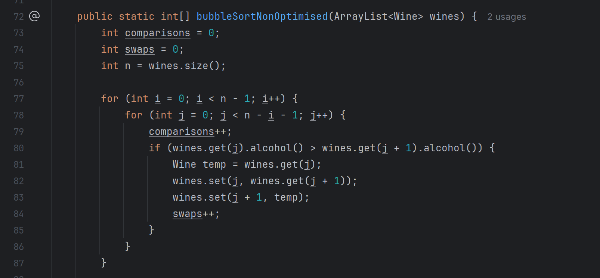
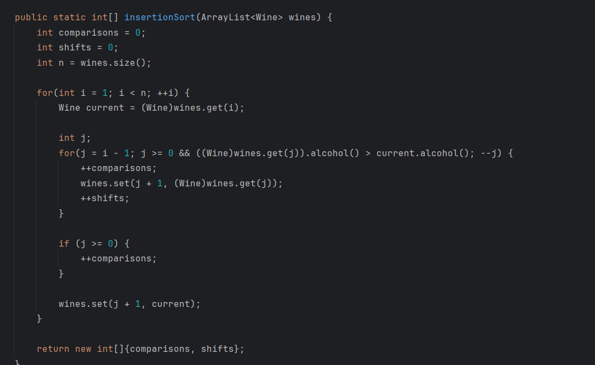
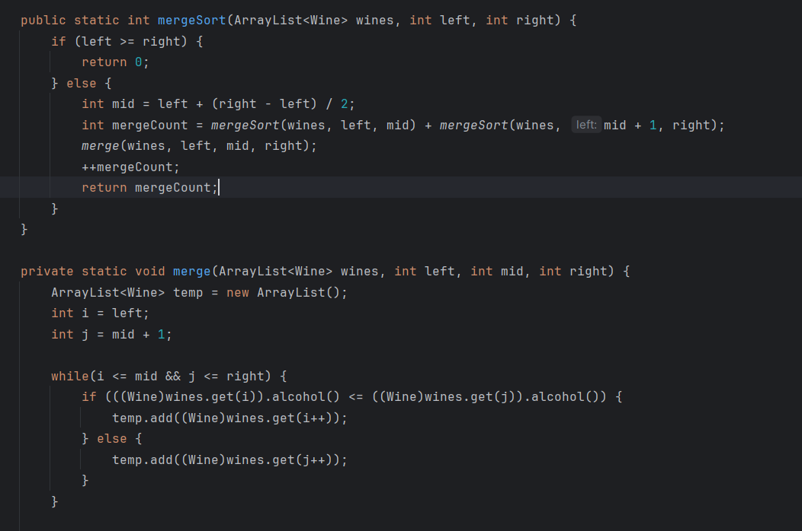
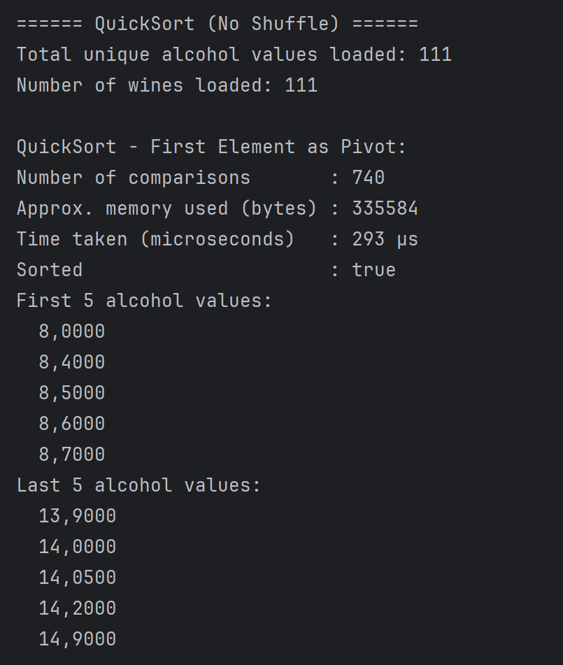
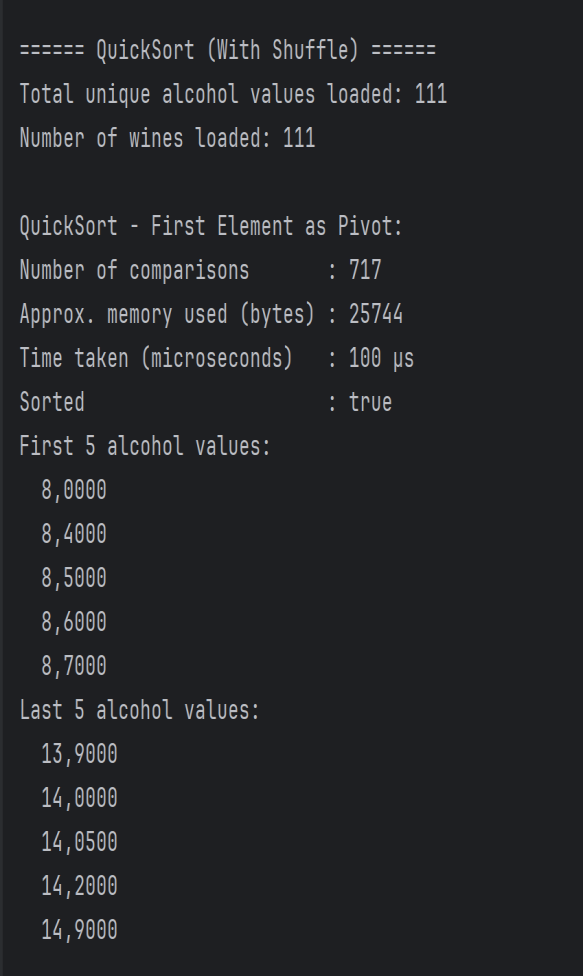

# Analyse av sorteringsalgoritmer

Implementering og ytelsestesting av fire sorteringsalgoritmer i Java på et ekte datasett.

## Oversikt

Oppgaven var å implementere Bubble Sort, Insertion Sort, Merge Sort og Quick Sort fra bunnen av, kjøre dem på et ekte datasett og analysere hvordan de oppfører seg med og uten stokking. Dataene var **Wine Quality Dataset**, alle unike alkoholverdier fra CSV-filene for rødvin og hvitvin, som gir **111 unike verdier** som skal sorteres i stigende rekkefølge.

Hver algoritme teller sine egne sammenligninger, bytter/flyttinger og flettinger, slik at teorien kan sjekkes mot målte tall.

## Resultater

**Bubble Sort** (ikke optimalisert og optimalisert med flagg for tidlig avslutning)

| | Sammenligninger (uten stokking) | Sammenligninger (med stokking) |
|---|---|---|
| Ikke optimalisert | 6105 | 6105 |
| Optimalisert | 5895 | 6105 |

Den ikke optimaliserte versjonen gjør alltid like mye arbeid (O(n²) i alle tilfeller). I den optimaliserte versjonen gjør `swapped`-flagget at den kan avslutte tidlig på nesten sorterte data, beste tilfelle O(n).

**Insertion Sort**: 2 711 sammenligninger uten stokking, 3 324 med stokking. Følsom for rekkefølgen på input; beste tilfelle O(n), gjennomsnitt og verste tilfelle O(n²).

**Merge Sort**: nøyaktig **110 flettinger** i begge kjøringene, uavhengig av rekkefølge. Antall sammenligninger endret seg nesten ikke (599 → 615). Garantert O(n log n) og upåvirket av rekkefølgen på input.

**Quick Sort**: fire strategier for valg av pivot ble sammenlignet:

| Strategi | Sammenligninger (uten stokking) | Sammenligninger (med stokking) |
|---|---|---|
| Første element | 740 | 717 |
| Siste element | 685 | 719 |
| Tilfeldig | 752 | 798 |
| Median av tre | **665** | **607** |

Median av tre var den mest stabile, og ga jevnt over de mest balanserte delingene og færrest sammenligninger.

## Viktigste lærdommer

- De enkle O(n²)-algoritmene (Bubble, Insertion) er svært følsomme for hvor sortert input allerede er
- Merge Sort gir stabil og forutsigbar ytelse uavhengig av rekkefølgen på input
- For Quick Sort betyr valget av pivot mye: median av tre unngår de dårligste delingene som en naiv pivot på første element kan få på delvis sorterte data

## Skjermbilder

Implementasjoner i Java (Bubble, Insertion, Merge Sort):





Eksempel på utskrift fra Quick Sort, uten og med stokking:




## Kildekode

Hele Java-koden ligger i [`src/`](src):

| Fil | Hva den gjør |
|------|-------------|
| `Wine.java` | En record som holder alkoholverdien til én vin |
| `ImportData.java` | Laster inn unike alkoholverdier fra CSV-filene for rødvin og hvitvin |
| `Timer.java` | Måler kjøretid i mikrosekunder |
| `Task1_BubbleSort.java` | Bubble Sort, optimalisert og ikke optimalisert |
| `Task2_InsertionSort.java` | Insertion Sort |
| `Task3_MergeSort.java` | Merge Sort |
| `Task4_QuickSort.java` | Quick Sort med fire pivotstrategier |

Hver `TaskN`-fil teller sine egne sammenligninger, bytter/flyttinger/flettinger, tar tiden på kjøringen og skriver ut resultatet både for den opprinnelige og en stokket liste.

## Kjøre det

Datainnlasteren leser `winequality-red.csv` og `winequality-white.csv` fra classpath (UCI Wine Quality Dataset, semikolonseparert). Legg begge CSV-filene der classpath finner dem, og kjør:

```bash
javac -d out src/*.java
java -cp out:sti/til/ressurser Task4_QuickSort
```

Bytt til `Task1_BubbleSort`, `Task2_InsertionSort` eller `Task3_MergeSort` for å kjøre de andre.

## Teknologi

Java · Analyse av Big O-kompleksitet · Wine Quality Dataset (Cortez mfl., 2009)
